

  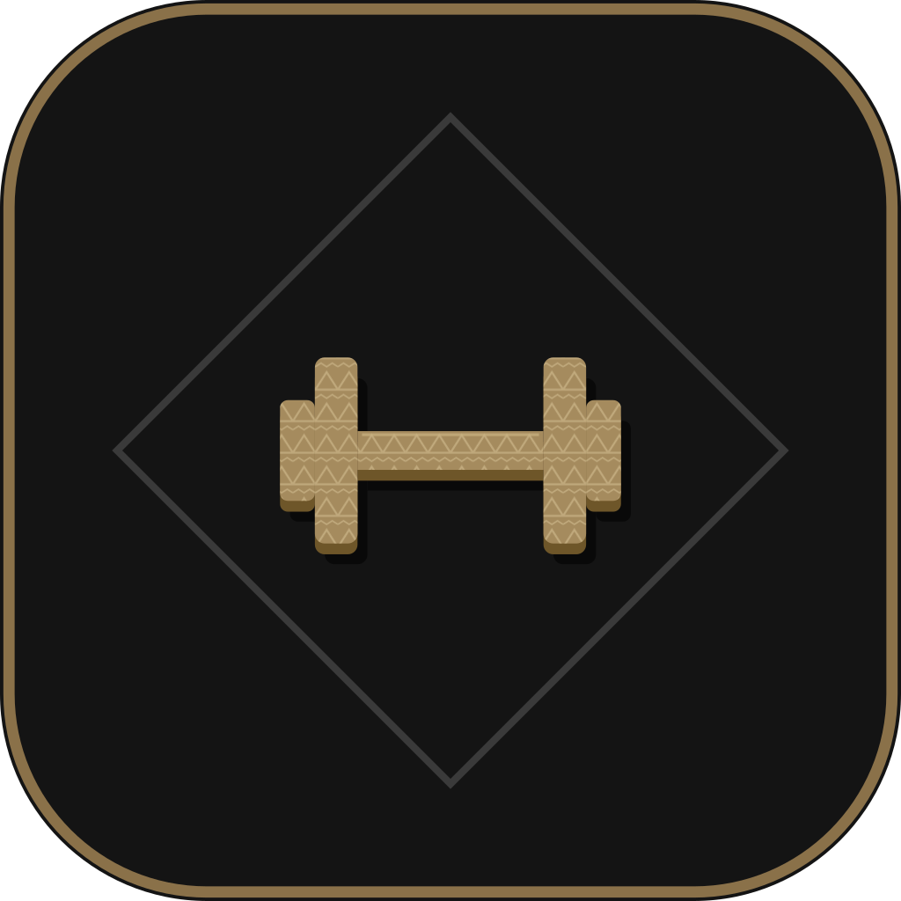

<h1 align="center">Teras</h1>

  A workout logger for strength training. 
  Log your sets, rest between them, and see your training build up week by week.

  <a href="https://github.com/faiz03-glicth/teras-releases/releases/latest"><b>Download the latest beta</b></a>
  &nbsp;·&nbsp; Android and iPhone &nbsp;·&nbsp; Bahasa Melayu and English

  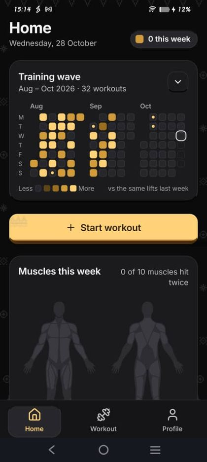
  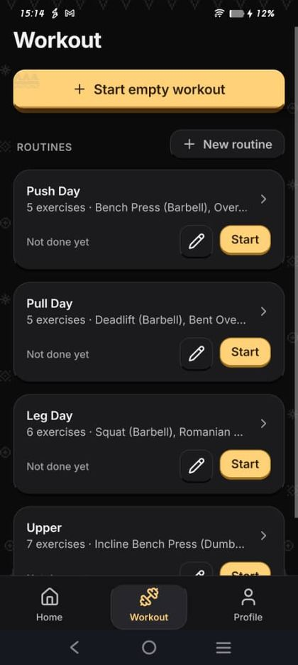
  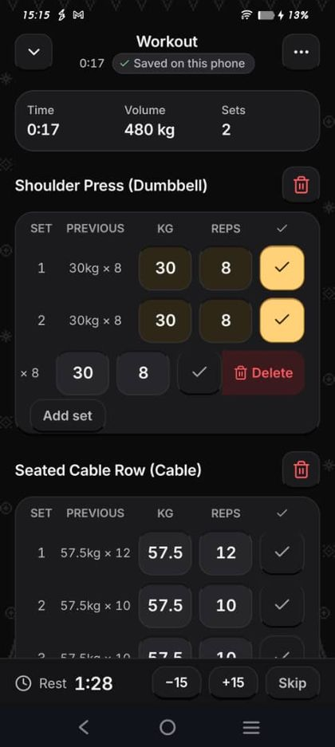

## Latest release

**Teras Beta 0.4.0**, 2 November 2026

- Pause a workout. Tap the clock to pause; the clock and the rest timer stop until you resume.
- The workout notification shows the exercise you are on, your current set and the exercise picture.
- On Android 16 and later, a running workout shows as a chip in the status bar.

[Download 0.4.0](https://github.com/faiz03-glicth/teras-releases/releases/latest) · [All releases](https://github.com/faiz03-glicth/teras-releases/releases)

## Download

| Phone | File | How to install |
|---|---|---|
| Android | `teras-beta-x.x.x.apk` | Open the file on your phone. If Android asks, allow installs from your browser or file manager. |
| iPhone | `teras-beta-x.x.x-unsigned.ipa` | Install it from a computer with Sideloadly or AltStore, signed with your Apple ID (a free one works). Then trust the app under Settings, General, VPN & Device Management. |

Updating keeps your data. Install the new version over the old one.

## What Teras does

**Log a workout.** Start from one of your routines or an empty workout. Each set shows what you lifted last time, and a rest timer starts when you tick a set. The rest alarm rings even when the app is closed.

  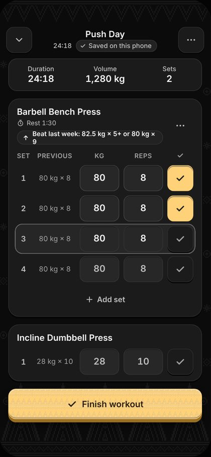
  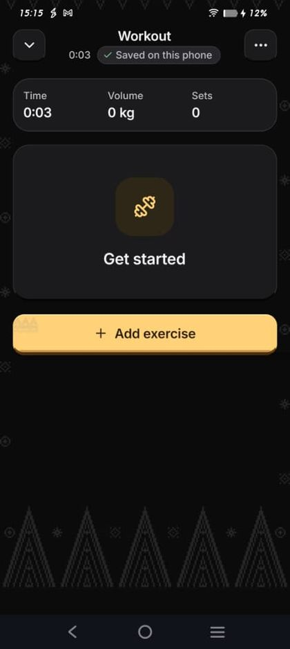
  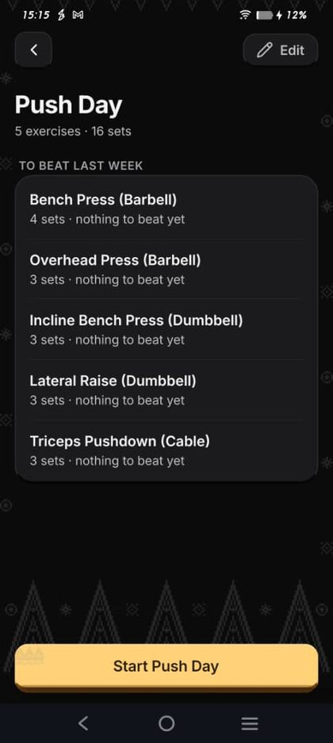

**See your training as a wave.** Every day you train fills a square on Home. A square gets darker when you lift more than the week before.

  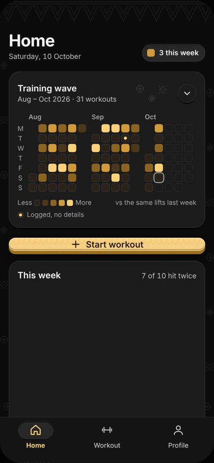
  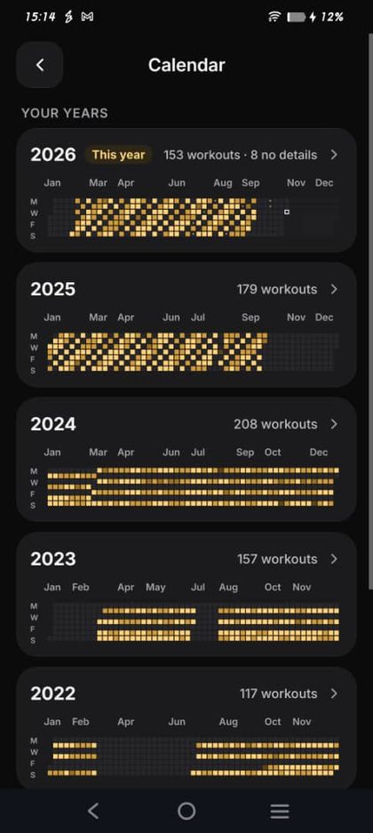
  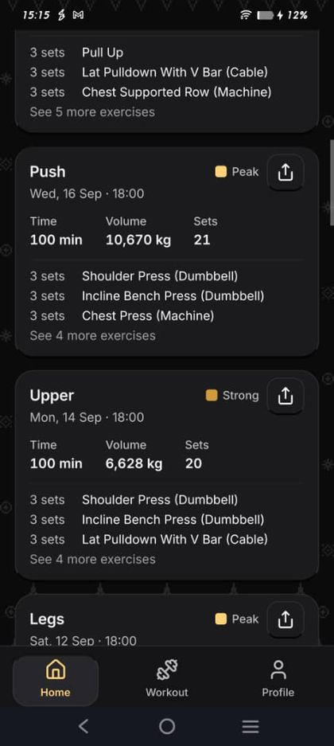

**Know which muscles you trained.** A body map shows the muscles you worked this week and how often. A spider chart shows which muscle groups are ahead and which are behind.

  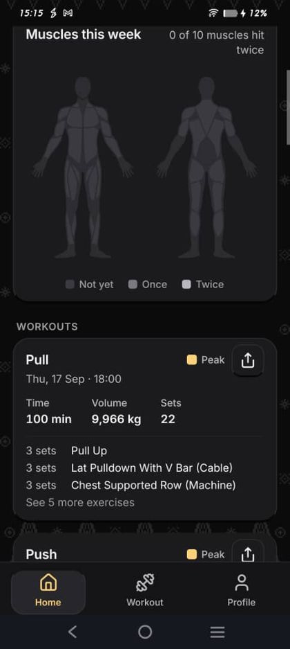
  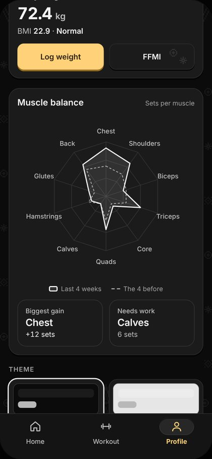
  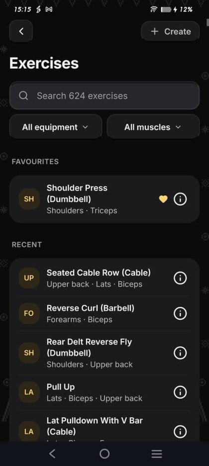

**Track your body and records.** Log your bodyweight and follow your BMI and FFMI. Personal records are marked on the set that made them.

  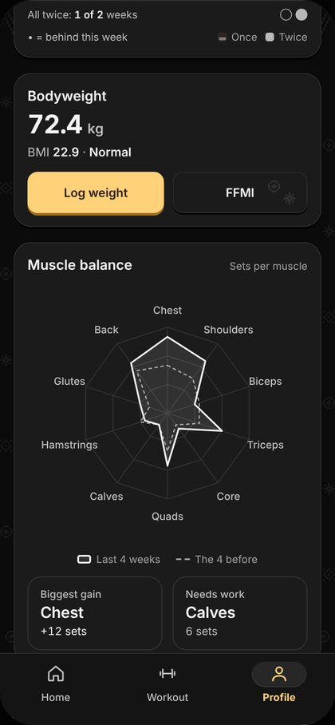
  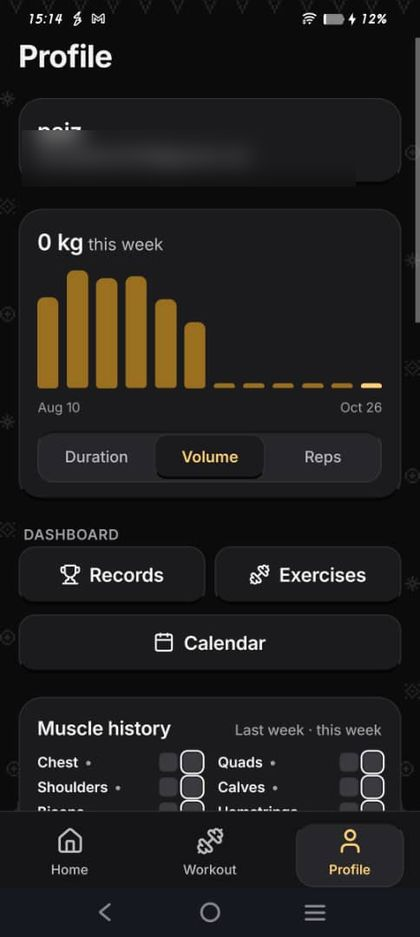

**Share a workout.** Turn a finished workout into a picture: the summary, your lifts or the muscles trained.

  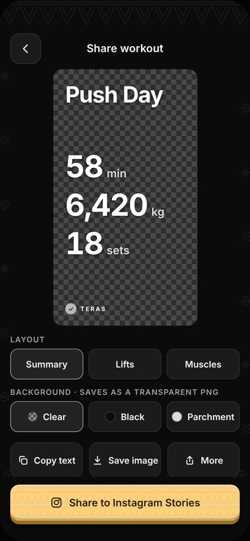
  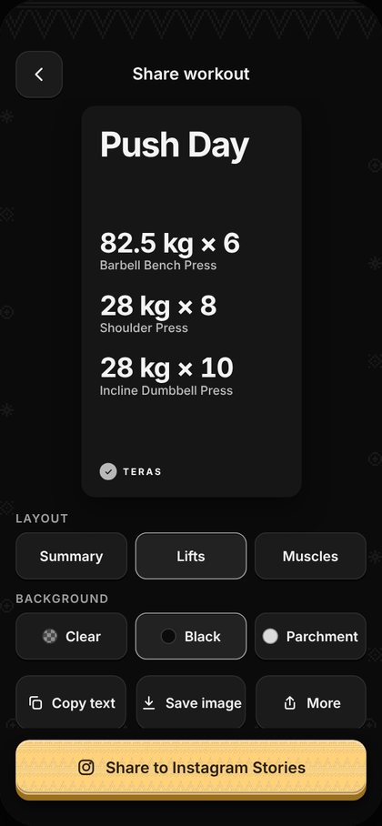
  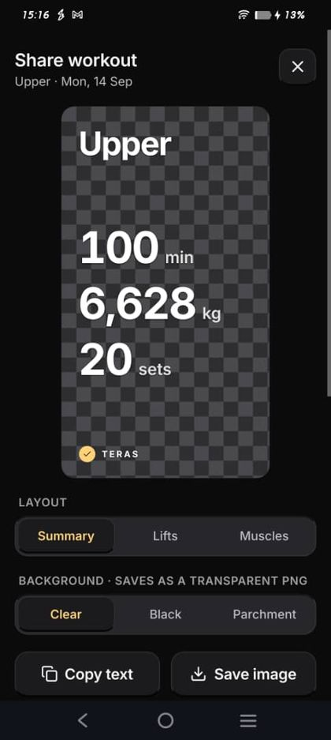

**Works without a connection.** Every workout is saved on your phone first, so you can log in a gym with no signal. When you sign in, your workouts are backed up.

  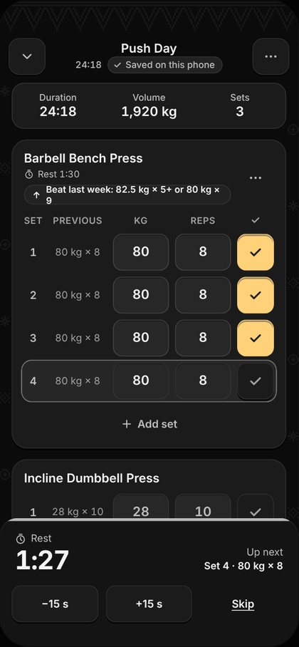

**Also included:** 1,123 exercises, each with a picture and a demo you can play; a short tour on first use; Bahasa Melayu and English; Gold and Grey themes in dark and light.

## Release history

| Version | Date | What changed |
|---|---|---|
| 0.4.0 | 2 Nov 2026 | Pause a workout. The notification shows your current exercise and set. Android 16 status bar chip. |
| 0.3.0 | 2 Nov 2026 | Exercise demos: a picture for every exercise, with an animation you can play. Version number on Profile. |
| 0.2.0 | 1 Nov 2026 | Workout in the notification bar and on the iPhone Lock Screen. Rest alarm. First-run tour. |
| 0.1.0 | 1 Nov 2026 | First public beta. Bahasa Melayu and English, the songket look and the theme wheel. |

Full notes for each version are on the [releases page](https://github.com/faiz03-glicth/teras-releases/releases).

## Coming next

- A new first-run experience: a short introduction to the app, set up and sign in.
- A Set done button on the workout notification.

## Support Teras

Teras is free. If you would like to support its development, you can [buy me a coffee](https://buymeacoffee.com/faizahmad) or use [DuitNow QR](support/README.md).

## Feedback

Teras is in beta, so things may still change. If something does not work, or you have an idea, please [open an issue](https://github.com/faiz03-glicth/teras-releases/issues). For questions and ideas, use [Discussions](https://github.com/faiz03-glicth/teras-releases/discussions). Include your phone model and the app version, shown under Log out on Profile.
