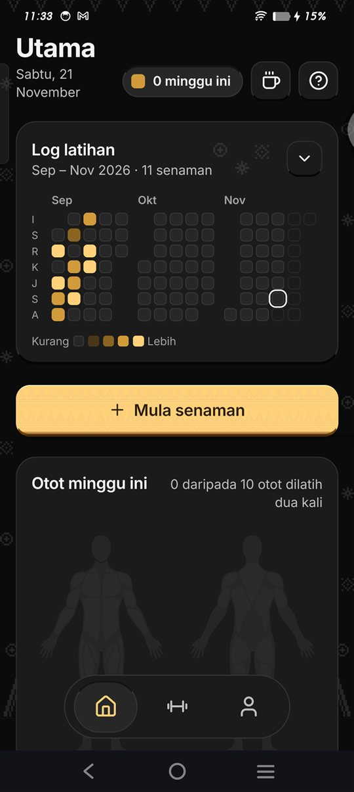
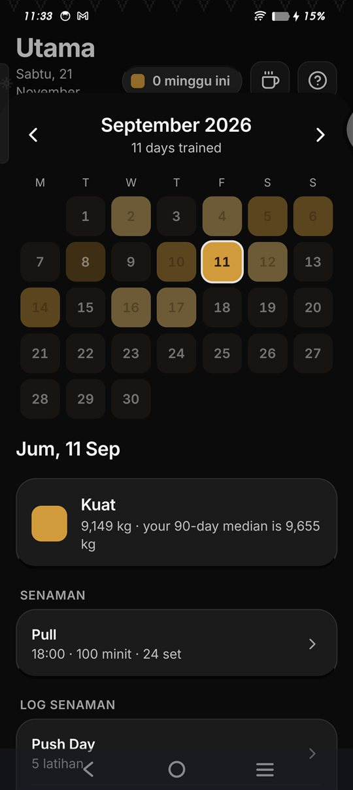
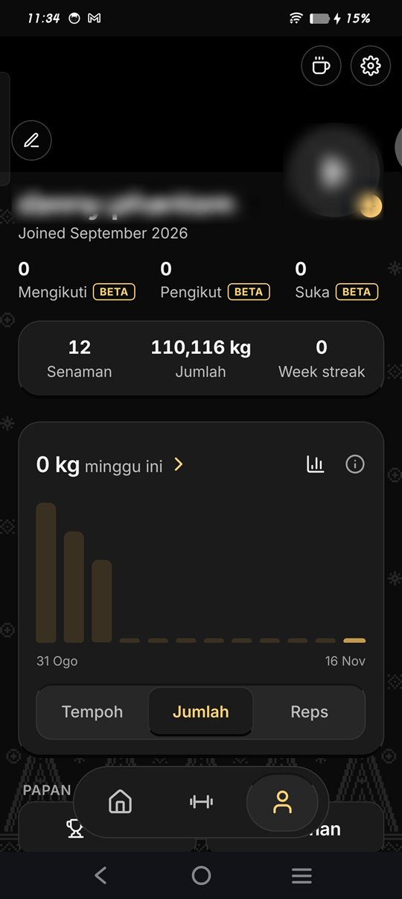

# Features

Everything Teras does, by area, and the version that brought it. Updated with every release.
Last updated 21 November 2026 (0.7.0).

## Logging a workout

| Feature | Since |
|---|---|
| Start from a routine or an empty workout | 0.1.0 |
| Each set shows what you lifted last time | 0.1.0 |
| Rest timer starts when you tick a set; the rest alarm rings even with the app closed | 0.2.0 |
| Workout in the notification bar and on the iPhone Lock Screen | 0.2.0 |
| Pause a workout | 0.4.0 |
| The notification shows your current exercise and set; Android 16 status bar chip | 0.4.0 |
| Instant set ticks | 0.5.0 |
| A soft green tick only once a set is done; centred stats | 0.7.0 |
| Saved on your phone first: log with no signal | 0.1.0 |

## Exercises

| Feature | Since |
|---|---|
| 1,123 exercises, each with a picture | 0.3.0 |
| A demo animation you can play | 0.3.0 |
| Filter by muscle on the body, or by equipment | 0.1.0 |
| Faster exercise list | 0.6.0 |
| Smoother search: the list follows when you pause typing | 0.7.0 |

## Home and the training wave

| Feature | Since |
|---|---|
| Training wave: a square for every day you train, darker when you beat last week | 0.1.0 |
| Muscles this week on a body map; muscle balance chart | 0.1.0 |
| Pick days from the wave: tap a month for its card, or hold and slide to a day | 0.7.0 |
| Show more on the workout feed: 20 at a time, back to six months | 0.7.0 |

  
  

## Profile and records

| Feature | Since |
|---|---|
| Bodyweight, BMI and FFMI | 0.1.0 |
| Personal records marked on the set that made them | 0.1.0 |
| New Profile with cover photo, Settings and a weekly report; edit body | 0.5.0 |
| Faster records and history | 0.6.0 |
| Version on Profile | 0.3.0 |
| Plain cover, status strip; Following, Followers and Likes row | 0.7.0 |
| Build number under the version in Settings | 0.7.0 |

  

## Sharing

| Feature | Since |
|---|---|
| Share a workout as a picture: summary, lifts or muscles | 0.1.0 |
| Share one exercise | 0.5.0 |
| Clean titles: no clipped g or y, no stray dot | 0.7.0 |

## Look

| Feature | Since |
|---|---|
| The songket look and the theme wheel: Gold or Grey, dark or light | 0.1.0 |
| Body model: male or female, Polygon or Detailed | 0.6.0 |
| Simple look | 0.6.0 |
| Warmer, softer Light theme | 0.7.0 |

## Getting started

| Feature | Since |
|---|---|
| Bahasa Melayu and English | 0.1.0 |
| First-run tour | 0.2.0 |
| New first run and Set up | 0.5.0 |

## Account and privacy

| Feature | Since |
|---|---|
| Use Teras without an account, or sign in to back up | 0.1.0 |
| Google sign-in, "Sign in to Teras" | 0.6.1 |
| Syncing label | 0.6.0 |
| Sync stops after 30 seconds and cancels in the background | 0.6.3 |
| No telemetry: no crash reports or usage counts | 0.6.3 |
