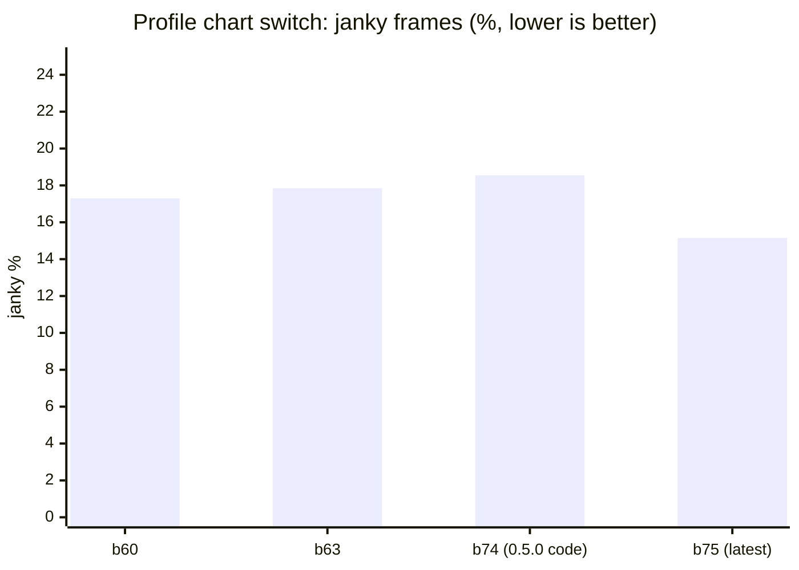
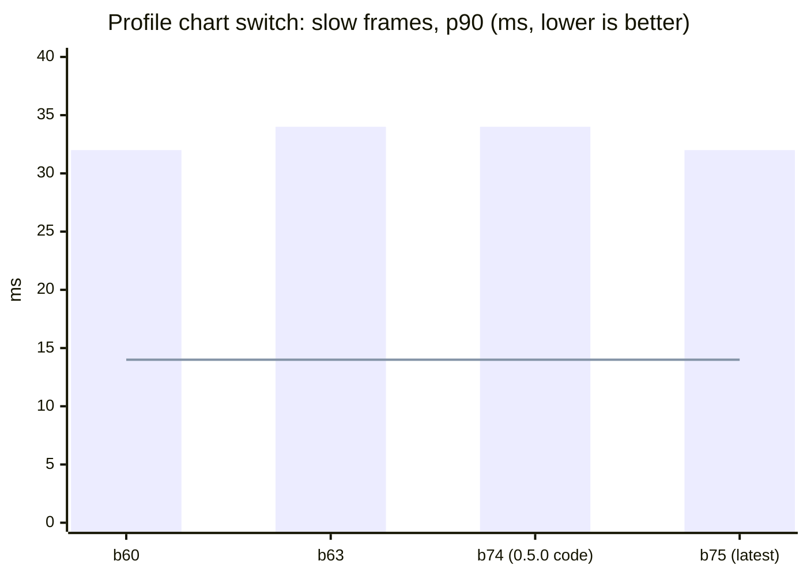
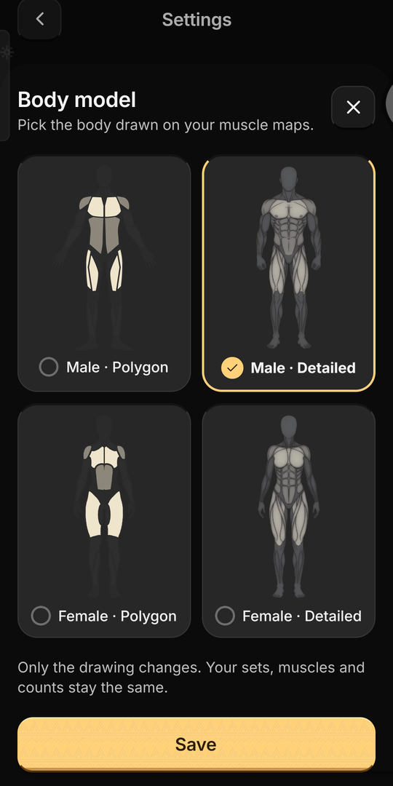
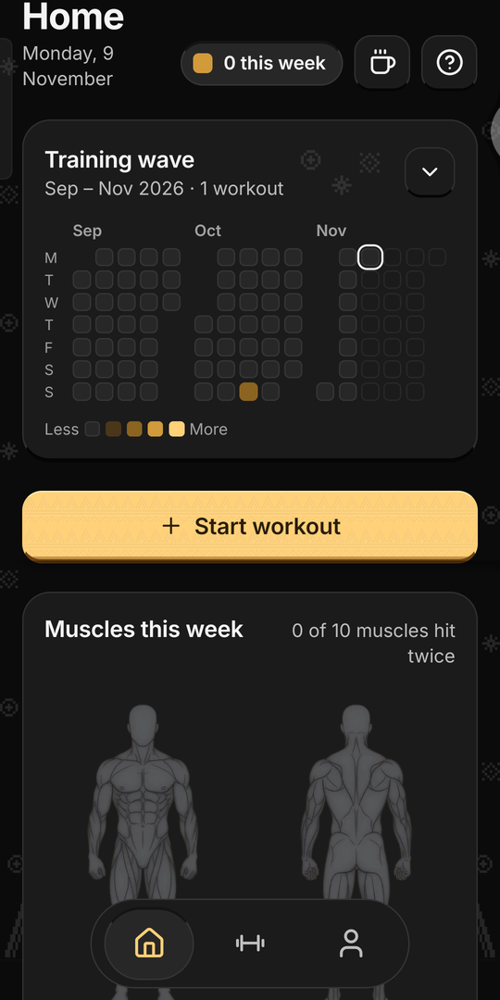

# Performance

**Published 9 November 2026.** Last updated 9 November 2026 (0.6.0).

How smooth Teras runs, build by build. Each new build is compared with the last public one. The latest release is **0.6.0 (build 82)**; it is compared with **0.5.0 (build 67)** below.

**How it is measured.** On a real phone (Android 16, Mali-G57 GPU, 60 Hz screen), with release builds only. A script taps and scrolls the same way every time, and Android counts every frame it draws. Each figure is the median of 3 runs.

- **Frame time (ms):** how long a frame took to draw. **p50** is the typical frame. **p90** and **p99** are the slow ones: 90% and 99% of frames came in under that time. Lower is better.
- **Janky %:** the share of frames Android counted as janky. Lower is better. It swings by several points from one run to the next, so p90 is the steadier measure.
- **Target:** p90 at most 14 ms, p99 at most 16.7 ms (one frame at 60 Hz), and janky at most 2%. No build meets it yet. These numbers show how far each build is from the target.

## 0.6.0 against 0.5.0

Measured on 9 November 2026 on the same phone, at 23–29 °C. **b79** is 0.5.0's code rebuilt; **b81** is 0.6.0's code (the release, build 82, adds only crash reports and usage counts).

New this round is **the walk** (`walk.csv`): one pass through most of the app. It goes Home, Profile, Home, Workout, then the exercise library: tap two muscles, scroll the list down and up, open an exercise and its share card. Back on Home it opens and closes the training wave, then starts an empty workout and discards it with the red key.

It also adds **missed frames**: the frames that really reached the screen late. Android's older "janky" count includes every frame over 16 ms, even those that still arrived on time, so it reads 30–40% on this phone while the missed frames are 2–6%.

| Test | Measure | 0.5.0 code (b79) | 0.6.0 code (b81) | |
|---|---|---:|---:|---|
| The walk | Missed frames | 5.79% | 5.90% | ✅ same, within run-to-run noise |
| The walk | p99 frame | 77 ms | 81 ms | ✅ same range (77–85 ms both) |
| Home scroll | p90 / p99 frame | 36 / 44 ms | 36–42 / 42–44 ms | ✅ |
| Chart switch | Missed frames | 3.2–3.7% | 3.5–4.0% | ✅ |
| Start-up | Cold start | 1,200 ms | 1,182 ms | ✅ 18 ms sooner |
| App size | APK | 76.45 MB | 77.39 MB | ✅ +0.94 MB (the Detailed body figures) |
| Memory | Graphics, Home settled | 39.4 MB | 40.4 MB | ✅ no growth |

**Result:** 0.6.0 is as smooth as 0.5.0 while adding the Body model, Simple look, the sync label and the coffee key, and it starts a little sooner.

**About memory.** The graphics reading lands near 15 MB or near 40 MB depending on the state of Android's GPU cache, not on the build: 0.5.0's code read 39 MB in one run and 15 MB in another. About 11 MB of it is marked purgeable, which Android frees when memory is needed. Compare builds within the same state only.

**What was tried and taken out.** Turning the wallpaper off saved about 0.7 ms a frame (b76). Turning soft shadows off changed nothing in Dark, which has none (b77). Caching Home's muscle map and wave as GPU textures saved nothing (b78). The cost is the phone drawing a busy screen each frame, not any one effect.

**Database.** On three heavy years of training (627 workouts, 15,048 sets), timed on a computer: Profile's records 37 → 14 ms, the library's Recent list 21 → 1 ms, and history and the running-workout check no longer read every workout. Expect a phone to be several times slower, so these were visible pauses before.

## Earlier: 0.5.0 against test build b75 (fair test)

Measured on 9 November 2026, back to back on the same phone at 28–30 °C. To compare like with like, both versions were rebuilt and measured together:

- **b74** is 0.5.0's code.
- **b75** is the latest test code: the body model setting and the coffee key, with the default body, Male · Polygon.

| Test | Measure | 0.5.0 code (b74) | Latest (b75) | Change | Allowed | |
|---|---|---:|---:|---:|---:|---|
| Home scroll | p90 frame | 36 ms | 36 ms | 0 | +1 ms | ✅ |
| Home scroll | p99 frame | 44 ms | 44 ms | 0 | | ✅ |
| Chart switch | p90 frame | 34 ms | 32 ms | −2 ms | | ✅ |
| Chart switch | Janky | 18.55% | 15.15% | −3.4 pts | | ✅ |
| Start-up | Cold start | 1,249 ms | 1,254 ms | +5 ms | +30 ms | ✅ |
| App size | APK | 76.45 MB | 77.38 MB | +0.92 MB | +1 MB | ✅ |
| Memory | Total, Home settled | not measured * | 207.2 MB | to come | +0 MB (Polygon) | ⏳ |

**Result:** with the default Polygon body, the new features cost no smoothness. Slow frames are the same or faster on both screens, cold start is 5 ms slower, and the app is 0.92 MB bigger. All of these are within their allowances. Memory is still to be compared (* b74's only reading was taken before Home had settled, and b74 can no longer be installed over b75; 0.5.0's code will be rebuilt under a higher build number and measured).

## Home scroll

Six scrolls down and up past the muscle map.

```mermaid
xychart-beta
  title "Home scroll, fair test: frame time (ms, lower is better)"
  x-axis ["p50", "p90", "p99"]
  y-axis "ms" 0 --> 60
  bar [19, 36, 44]
  bar [20, 36, 44]
```

First bar of each pair: 0.5.0's code (b74). Second: the latest (b75).

| Build | Measured | Janky % | p50 | p90 | p99 | Frames | Note |
|---|---|---:|---:|---:|---:|---:|---|
| b74 (0.5.0 code) | 9 Nov 2026 | (41.38) | 19 | 36 | 44 | 576 | Cool phone. The app left the screen mid-run, so its janky % is left out |
| b75 (latest, Polygon) | 9 Nov 2026 | 38.54 | 20 | 36 | 44 | 936 | Cool phone |
| b67 (0.5.0) | 9 Nov 2026 | 35.94 | 21 | 36 | 44 | 803 | First measurement |
| b70 (Polygon), run 1 | 9 Nov 2026 | 38.51 | 21 | 36 | 48 | 940 | Warm phone |
| b70 (Polygon), run 2 | 9 Nov 2026 | 32.48 | 20 | 36 | 46 | 939 | Warm phone |

Data: [home-scroll.csv](home-scroll.csv)

## Profile chart switch

Thirty taps between Duration, Volume and Reps on the Profile chart. Only the switches are counted.

The line is the 14 ms target.

| Build | Measured | Janky % | p50 | p90 | p99 | Frames | Note |
|---|---|---:|---:|---:|---:|---:|---|
| b60 | 8 Nov 2026 | 17.3 | 22 | 32 | 38 | 1,006 | |
| b63 | 8 Nov 2026 | 17.85 | 22 | 34 | 38 | 997 | |
| b67 (0.5.0) | 9 Nov 2026 | 10.77 | 20 | 24 | 38 | 986 | A lucky run, see below |
| b70 (Polygon) | 9 Nov 2026 | 19.92 | 21 | 34 | 40 | 999 | Warm phone |
| b74 (0.5.0 code) | 9 Nov 2026 | 18.55 | 19 | 34 | 38 | 985 | Cool phone |
| b75 (latest, Polygon) | 9 Nov 2026 | 15.15 | 20 | 32 | 38 | 988 | Cool phone |

**A correction.** This page first showed 0.5.0 (b67) with 10.77% janky frames and a 24 ms p90 on the chart switch, and said 0.5.0 had cut janky frames by about 40%. That was a lucky run. The same code measured again on a cool phone (b74) gives 18.55% and 34 ms, about the same as b60 and b63. The latest build (b75) is a little better than that: 15.15% and 32 ms.

Data: [profile-switch.csv](profile-switch.csv)

## Start-up, memory and size

| Measure | 0.5.0 code (b74) | Latest (b75) | Change | Allowed change |
|---|---:|---:|---:|---:|
| Cold start | 1,249 ms | 1,254 ms | +5 ms | +30 ms |
| Memory once Home settles (total PSS) | not measured * | 207.2 MB | to come | +8 MB (Detailed), +0 (Polygon) |
| Graphics memory | not measured * | 15.3 MB | to come | |
| APK | 76,453,848 B | 77,377,213 B | +923,365 B | +1 MB |

Measured on 9 November 2026. Cold start is the median of 5 runs:
- b74: 1,269, 1,247, 1,246, 1,256 and 1,249 ms.
- b75: 1,254, 1,274, 1,273, 1,212 and 1,248 ms.

\* b74's only memory reading was taken before Home had settled (graphics read 39.6 MB, against about 15 MB once settled), so it is not used.

**Earlier readings.** These are not used for the comparison.
- b67 (0.5.0): 203.1 MB total, 15.1 MB graphics, 1,266 ms cold start.
- b70 (warm phone): 209.2 MB, 16.0 MB and 1,347 ms. Memory also moves with how much the phone has swapped out: 109 MB for b70 against 45 MB for b67.

Data: [baseline.csv](baseline.csv)

## Polygon or Detailed body

Settings → Body model picks the figure drawn on the muscle maps. Detailed draws a shaded anatomy picture instead of flat shapes, so it was measured on its own. The test used b75, Male, on a cool phone (28.8 → 28.7 °C), on 9 November 2026.

  
  

| Measure | Polygon | Detailed | Change | Allowed | |
|---|---:|---:|---:|---:|---|
| Home scroll p90 / p99 | 36 / 44 ms | 36 / 44 ms | 0 | +1 ms | ✅ |
| Home scroll janky | 38.54% | 42.35% | +3.8 pts | | within the usual run-to-run swing |
| Chart switch p90 | 32 ms | 32 ms | 0 | | ✅ |
| Chart switch janky | 15.15% | 14.69% | −0.5 pts | | ✅ |
| Cold start | 1,254 ms | 1,253 ms | −1 ms | +30 ms | ✅ |
| Memory (total PSS) | 207.2 MB | 207.5 MB | +0.3 MB | +8 MB | ✅ |
| Graphics memory | 15.3 MB | 15.3 MB | 0 | | ✅ |

**Result:** Detailed costs about the same as Polygon. Cold start for Detailed is the median of 1,253, 1,251, 1,229, 1,268 and 1,282 ms.

## Where the slow frames come from

Two test copies of b75, each with one thing taken out, measured in Dark on a cool phone on 9 November 2026. They are test builds only, not releases.

| Build | What was taken out | Home p90 / p99 | Chart switch p90 | Cold start |
|---|---|---:|---:|---:|
| b75 (Polygon) | nothing | 36 / 44 ms | 32 ms | 1,254 ms |
| b76 | the songket wallpaper | 36 / 42 ms | 32 ms | 1,209 ms |
| b77 | the soft shadows | 36 / 44 ms | 34 ms | 1,223 ms |

**Finding:** neither the wallpaper nor the soft shadows explains the slow frames in Dark.
- Dark draws no blurred shadows at all, and the wallpaper costs only about 0.7 ms of graphics time a frame.
- The time goes on two things: preparing the drawing for each frame (about 8 ms) and the graphics chip drawing it (about 10.6 ms).
- So the next fixes cut how much each frame has to draw.

Janky % for these runs is in the CSV files. b76's memory reading is not usable (Home had not settled). b77 read 201.7 MB total and 16.1 MB graphics.

## Coming next

- b78: a Simple look setting (no wallpaper, no soft shadows) for slower phones, shorter screen transitions, and Home's muscle map and training wave kept ready on the graphics chip.
- Memory for 0.5.0's code on a settled Home, rebuilt under a higher build number.

Earlier runs on b56 to b63 used a different walk (it also opened Profile) or ran with Reduce Motion on, so they are left out of these comparisons.
