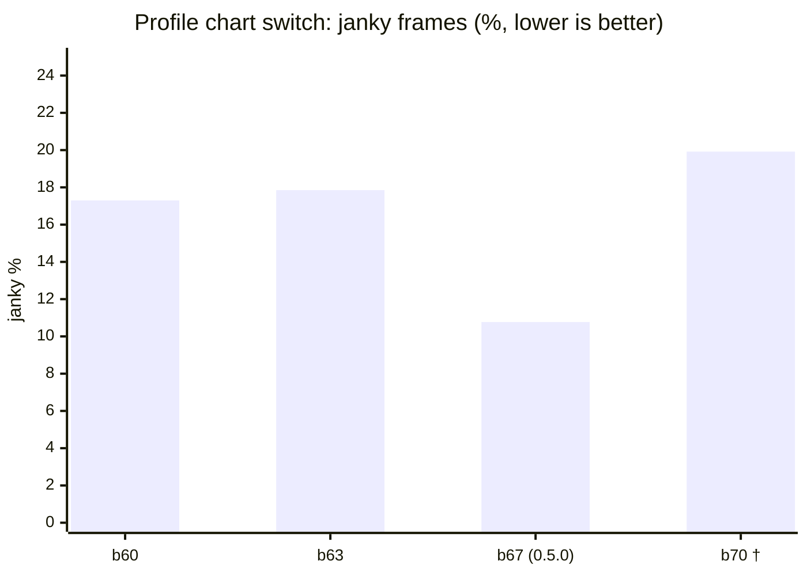
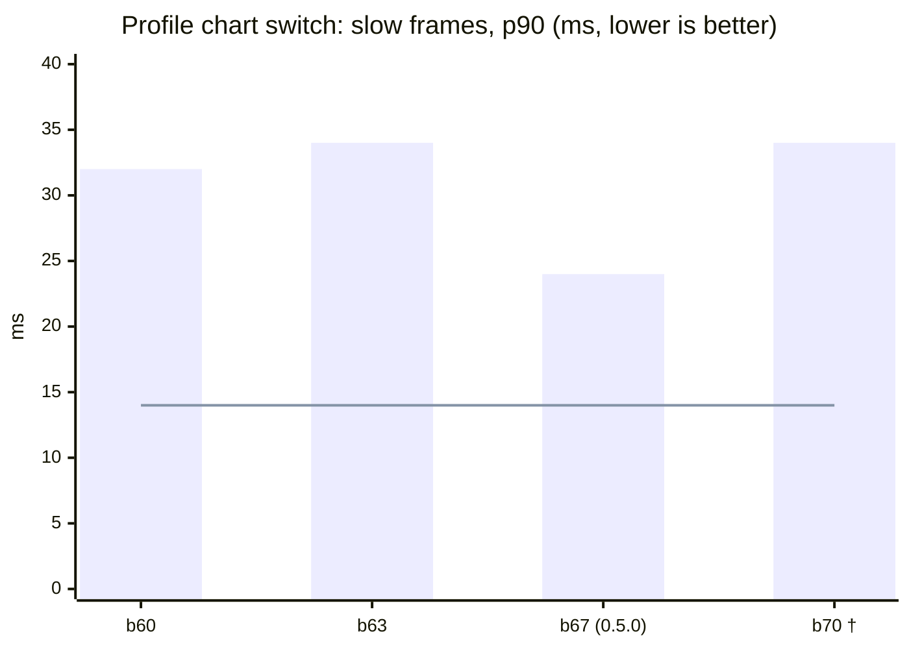

# Performance

**Published 9 November 2026.** Last updated 9 November 2026.

How smooth Teras runs, build by build. Each new build is compared with the last public one, **0.5.0 (build 67)**.

**How it is measured.** On a real phone (Android 16, Mali-G57 GPU, 60 Hz screen), with release builds only. A script taps and scrolls the same way every time, and Android counts every frame it draws. Each figure is the median of 3 runs.

- **Frame time (ms):** how long a frame took to draw. **p50** is the typical frame. **p90** and **p99** are the slow ones: 90% and 99% of frames came in under that time. Lower is better.
- **Janky %:** the share of frames Android counted as janky. Lower is better. It swings by about 3 points from one run to the next, so p90 is the steadier measure.
- **Target:** p90 at most 14 ms, p99 at most 16.7 ms (one frame at 60 Hz), and janky at most 2%. No build meets it yet. These numbers show how far each build is from the target.

## Summary: 0.5.0 against the latest test build

Measured on 9 November 2026. The latest test build is **build 70**, which adds the body model setting and the coffee key. Its body model is the default, Male · Polygon.

> **Not a fair test yet.** The phone was warmer for build 70 (29.5 °C rising to 33.4 °C) than for 0.5.0 (29.2 to 28.6 °C). A warm phone runs slower, so the gaps marked † are not trusted yet. Memory also moves with how much the phone has swapped out (109 MB during the build 70 run, 45 MB during the 0.5.0 run). A fair re-test is in progress: the same two versions rebuilt as builds 74 and 75 and measured on a cool phone.

| Test | Measure | 0.5.0 (b67) | b70 | Change | Allowed |
|---|---|---:|---:|---:|---:|
| Home scroll | p50 frame | 21 ms | 20–21 ms | 0 | |
| Home scroll | p90 frame | 36 ms | 36 ms | 0 | +1 ms |
| Home scroll | p99 frame | 44 ms | 46–48 ms | +2 to +4 ms | |
| Home scroll | Janky | 35.94% | 32.48–38.51% | −3.5 to +2.6 pts | +0.5 pts |
| Chart switch | p90 frame † | 24 ms | 34 ms | +10 ms | |
| Chart switch | Janky † | 10.77% | 19.92% | +9.2 pts | |
| Memory | Total, Home settled † | 203.1 MB | 209.2 MB | +6.2 MB | +0 MB (Polygon) |
| Start-up | Cold start † | 1,266 ms | 1,347 ms | +81 ms | +30 ms |
| App size | APK | 76.45 MB | 77.38 MB | +0.92 MB | +1 MB |

**What holds so far:** Home's typical and slow frames are the same as 0.5.0, and the app grew 0.92 MB, within its allowance. Home's janky share came out higher on one run and lower on the other, which is within its normal swing.

**What needs the fair re-test:** the chart switch, memory and cold start all came out worse on build 70, and all of them were measured on the warmer phone.

## Home scroll

Six scrolls down and up past the muscle map. Build 70 was measured twice.

```mermaid
xychart-beta
  title "Home scroll: frame time (ms, lower is better)"
  x-axis ["p50", "p90", "p99"]
  y-axis "ms" 0 --> 60
  bar [21, 36, 44]
  bar [21, 36, 48]
  bar [20, 36, 46]
```

Bars in each group: 0.5.0 (b67), then b70 run 1, then b70 run 2.

| Build | Measured | Janky % | p50 | p90 | p99 | Frames |
|---|---|---:|---:|---:|---:|---:|
| b67 (0.5.0) | 9 Nov 2026 | 35.94 | 21 | 36 | 44 | 803 |
| b70 (Polygon), run 1 | 9 Nov 2026 | 38.51 | 21 | 36 | 48 | 940 |
| b70 (Polygon), run 2 | 9 Nov 2026 | 32.48 | 20 | 36 | 46 | 939 |

Data: [home-scroll.csv](home-scroll.csv)

## Profile chart switch

Thirty taps between Duration, Volume and Reps on the Profile chart. Only the switches are counted.

The line is the 14 ms target. † b70 ran on a warmer phone (see the summary).

| Build | Measured | Janky % | p50 | p90 | p99 | Frames |
|---|---|---:|---:|---:|---:|---:|
| b60 | 8 Nov 2026 | 17.3 | 22 | 32 | 38 | 1,006 |
| b63 | 8 Nov 2026 | 17.85 | 22 | 34 | 38 | 997 |
| b67 (0.5.0) | 9 Nov 2026 | 10.77 | 20 | 24 | 38 | 986 |
| b70 (Polygon) † | 9 Nov 2026 | 19.92 | 21 | 34 | 40 | 999 |

0.5.0 made the chart switch draw at once: about 40% fewer janky frames than b63, and its slow frames are 10 ms faster. Build 70 lost that gain on the warmer phone; the fair re-test will show whether the loss is real.

Data: [profile-switch.csv](profile-switch.csv)

## Memory, start-up and size

| Measure | 0.5.0 (b67) | b70 (Polygon) | Change | Allowed change |
|---|---:|---:|---:|---:|
| Memory once Home settles (total PSS) † | 203.1 MB | 209.2 MB | +6.2 MB | +8 MB (Detailed), +0 (Polygon) |
| Graphics memory † | 15.1 MB | 16.0 MB | +1.0 MB | |
| Cold start † | 1,266 ms | 1,347 ms | +81 ms | +30 ms |
| APK | 76,453,848 B | 77,377,213 B | +923,365 B | +1 MB |

Both measured on 9 November 2026. Cold start is the median of 5 runs:
- 0.5.0: 1,281, 1,297, 1,246, 1,243 and 1,266 ms.
- b70: 1,371, 1,364, 1,322, 1,329 and 1,347 ms.

Data: [baseline.csv](baseline.csv)

## Coming next

- Two test builds that look for where the slow frames come from: b71 without the wallpaper, and b72 without blurred shadows.
- The fair re-test: 0.5.0's code as b74 and build 70's code as b75, both on a cool phone.
- b70 with the Detailed body.

Earlier runs on b56 to b63 used a different walk (it also opened Profile) or ran with Reduce Motion on, so they are left out of these comparisons.
