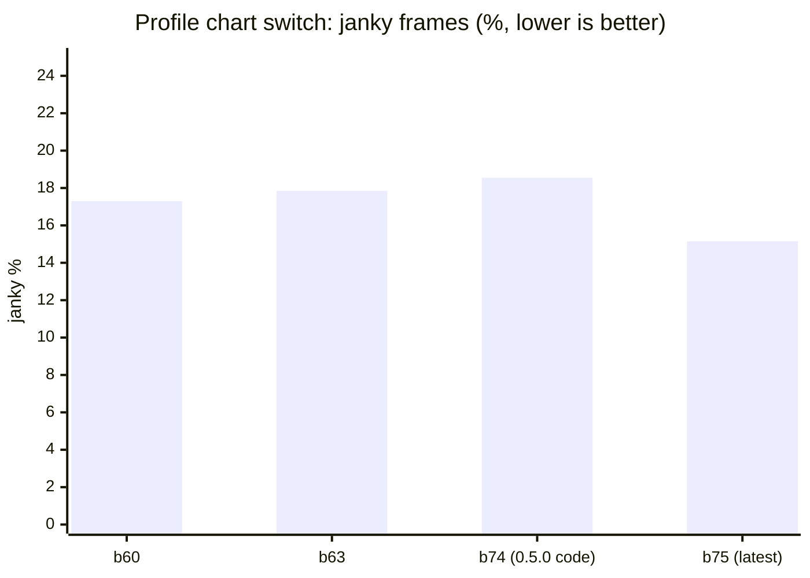
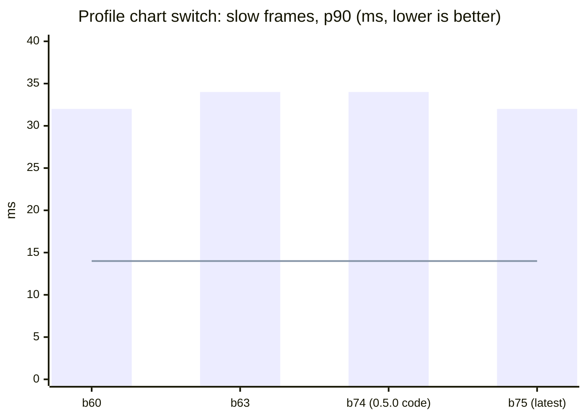

# Performance

**Published 9 November 2026.** Last updated 9 November 2026.

How smooth Teras runs, build by build. Each new build is compared with the last public one, **0.5.0 (build 67)**.

**How it is measured.** On a real phone (Android 16, Mali-G57 GPU, 60 Hz screen), with release builds only. A script taps and scrolls the same way every time, and Android counts every frame it draws. Each figure is the median of 3 runs.

- **Frame time (ms):** how long a frame took to draw. **p50** is the typical frame. **p90** and **p99** are the slow ones: 90% and 99% of frames came in under that time. Lower is better.
- **Janky %:** the share of frames Android counted as janky. Lower is better. It swings by several points from one run to the next, so p90 is the steadier measure.
- **Target:** p90 at most 14 ms, p99 at most 16.7 ms (one frame at 60 Hz), and janky at most 2%. No build meets it yet. These numbers show how far each build is from the target.

## Summary: 0.5.0 against the latest test build (fair test)

Measured on 9 November 2026, back to back on the same phone at 28–30 °C. To compare like with like, both versions were rebuilt and measured together:

- **b74** is 0.5.0's code.
- **b75** is the latest test code: the body model setting and the coffee key, with the default body, Male · Polygon.

| Test | Measure | 0.5.0 code (b74) | Latest (b75) | Change | Allowed | |
|---|---|---:|---:|---:|---:|---|
| Home scroll | p90 frame | 36 ms | 36 ms | 0 | +1 ms | ✅ |
| Home scroll | p99 frame | 44 ms | 44 ms | 0 | | ✅ |
| Chart switch | p90 frame | 34 ms | 32 ms | −2 ms | | ✅ |
| Chart switch | Janky | 18.55% | 15.15% | −3.4 pts | | ✅ |
| Start-up | Cold start | 1,249 ms | 1,254 ms | +5 ms | +30 ms | ✅ |
| App size | APK | 76.45 MB | 77.38 MB | +0.92 MB | +1 MB | ✅ |
| Memory | Total, Home settled | not usable * | 207.2 MB | to come | +0 MB (Polygon) | ⏳ |

**Result:** with the default Polygon body, the new features cost no smoothness. Slow frames are the same or faster on both screens, cold start is 5 ms slower, and the app is 0.92 MB bigger. All of these are within their allowances. Memory is still to be compared: b74's reading was taken before Home had settled (* its graphics memory read 39.6 MB, against about 15 MB once settled).

## Home scroll

Six scrolls down and up past the muscle map.

```mermaid
xychart-beta
  title "Home scroll, fair test: frame time (ms, lower is better)"
  x-axis ["p50", "p90", "p99"]
  y-axis "ms" 0 --> 60
  bar [19, 36, 44]
  bar [20, 36, 44]
```

First bar of each pair: 0.5.0's code (b74). Second: the latest (b75).

| Build | Measured | Janky % | p50 | p90 | p99 | Frames | Note |
|---|---|---:|---:|---:|---:|---:|---|
| b74 (0.5.0 code) | 9 Nov 2026 | (41.38) | 19 | 36 | 44 | 576 | Cool phone. The app left the screen mid-run, so its janky % is left out |
| b75 (latest, Polygon) | 9 Nov 2026 | 38.54 | 20 | 36 | 44 | 936 | Cool phone |
| b67 (0.5.0) | 9 Nov 2026 | 35.94 | 21 | 36 | 44 | 803 | First measurement |
| b70 (Polygon), run 1 | 9 Nov 2026 | 38.51 | 21 | 36 | 48 | 940 | Warm phone |
| b70 (Polygon), run 2 | 9 Nov 2026 | 32.48 | 20 | 36 | 46 | 939 | Warm phone |

Data: [home-scroll.csv](home-scroll.csv)

## Profile chart switch

Thirty taps between Duration, Volume and Reps on the Profile chart. Only the switches are counted.

The line is the 14 ms target.

| Build | Measured | Janky % | p50 | p90 | p99 | Frames | Note |
|---|---|---:|---:|---:|---:|---:|---|
| b60 | 8 Nov 2026 | 17.3 | 22 | 32 | 38 | 1,006 | |
| b63 | 8 Nov 2026 | 17.85 | 22 | 34 | 38 | 997 | |
| b67 (0.5.0) | 9 Nov 2026 | 10.77 | 20 | 24 | 38 | 986 | A lucky run, see below |
| b70 (Polygon) | 9 Nov 2026 | 19.92 | 21 | 34 | 40 | 999 | Warm phone |
| b74 (0.5.0 code) | 9 Nov 2026 | 18.55 | 19 | 34 | 38 | 985 | Cool phone |
| b75 (latest, Polygon) | 9 Nov 2026 | 15.15 | 20 | 32 | 38 | 988 | Cool phone |

**A correction.** This page first showed 0.5.0 (b67) with 10.77% janky frames and a 24 ms p90 on the chart switch, and said 0.5.0 had cut janky frames by about 40%. That was a lucky run. The same code measured again on a cool phone (b74) gives 18.55% and 34 ms, about the same as b60 and b63. The latest build (b75) is a little better than that: 15.15% and 32 ms.

Data: [profile-switch.csv](profile-switch.csv)

## Start-up, memory and size

| Measure | 0.5.0 code (b74) | Latest (b75) | Change | Allowed change |
|---|---:|---:|---:|---:|
| Cold start | 1,249 ms | 1,254 ms | +5 ms | +30 ms |
| Memory once Home settles (total PSS) | not usable * | 207.2 MB | to come | +8 MB (Detailed), +0 (Polygon) |
| Graphics memory | not usable * | 15.3 MB | to come | |
| APK | 76,453,848 B | 77,377,213 B | +923,365 B | +1 MB |

Measured on 9 November 2026. Cold start is the median of 5 runs:
- b74: 1,269, 1,247, 1,246, 1,256 and 1,249 ms.
- b75: 1,254, 1,274, 1,273, 1,212 and 1,248 ms.

\* b74's memory was read before Home had settled.

**Earlier readings.** These are not used for the comparison.
- b67 (0.5.0): 203.1 MB total, 15.1 MB graphics, 1,266 ms cold start.
- b70 (warm phone): 209.2 MB, 16.0 MB and 1,347 ms. Memory also moves with how much the phone has swapped out: 109 MB for b70 against 45 MB for b67.

Data: [baseline.csv](baseline.csv)

## Coming next

- The latest build with the **Detailed** body (the larger pictures; its memory allowance is +8 MB).
- Memory for 0.5.0's code on a settled Home.
- Two test builds that look for where the slow frames come from: b76 without the wallpaper, and b77 without blurred shadows.

Earlier runs on b56 to b63 used a different walk (it also opened Profile) or ran with Reduce Motion on, so they are left out of these comparisons.
