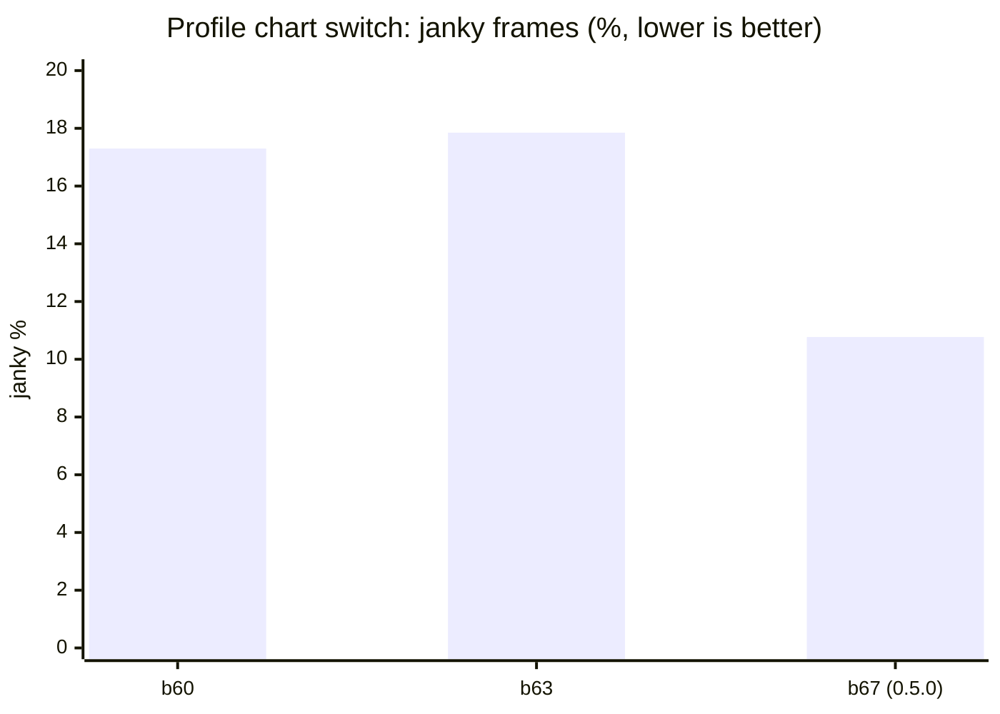
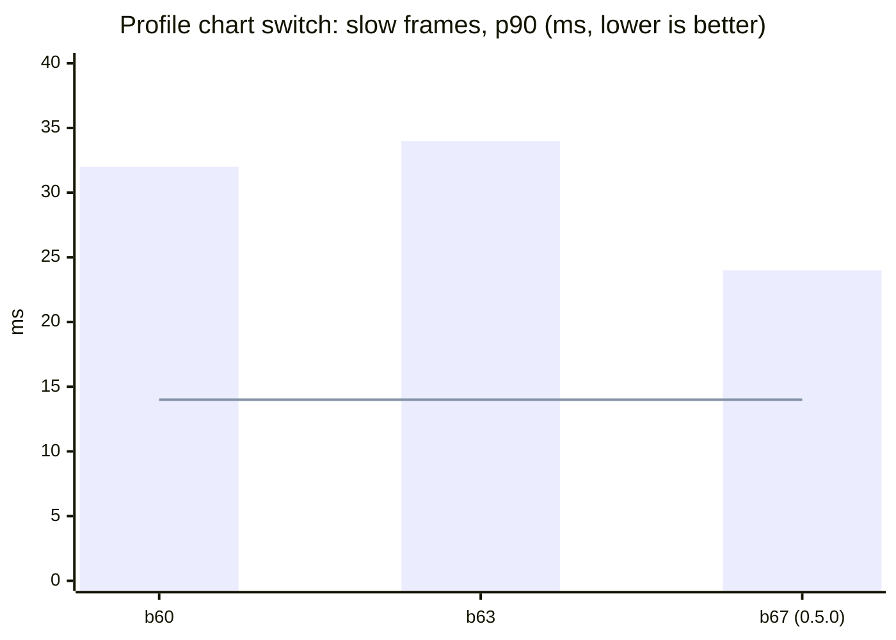

# Performance

**Published 9 November 2026.** Last updated 9 November 2026.

How smooth Teras runs, build by build. Each new build is compared with the last public one, **0.5.0 (build 67)**.

**How it is measured.** On a real phone (Android 16, Mali-G57 GPU, 60 Hz screen), with release builds only. A script taps and scrolls the same way every time, and Android counts every frame it draws. Each figure is the median of 3 runs.

- **Frame time (ms):** how long a frame took to draw. **p50** is the typical frame. **p90** and **p99** are the slow ones: 90% and 99% of frames came in under that time. Lower is better.
- **Janky %:** the share of frames Android counted as janky. Lower is better.
- **Target:** p90 at most 14 ms, p99 at most 16.7 ms (one frame at 60 Hz), and janky at most 2%. No build meets it yet. These numbers show how far each build is from the target.

## Summary: 0.5.0 against the latest test build

Measured on 9 November 2026. The latest test build is **build 70**, which adds the body model setting and the coffee key. Its body model is the default, Male · Polygon.

| Test | Measure | 0.5.0 (b67) | b70 | Change | Allowed |
|---|---|---:|---:|---:|---:|
| Home scroll | p50 frame | 21 ms | 21 ms | 0 | |
| Home scroll | p90 frame | 36 ms | 36 ms | 0 | +1 ms |
| Home scroll | p99 frame | 44 ms | 48 ms | +4 ms | |
| Home scroll | Janky | 35.94% | 38.51% | +2.6 pts | +0.5 pts |
| App size | APK | 76.45 MB | 77.38 MB | +0.92 MB | +1 MB |

The typical and slow frames on Home are unchanged. The janky share rose by 2.6 points, which is over its allowance. The three b70 runs drew different numbers of frames (334 to 1,799), so part of that rise may be noise; the test will be re-run back to back. The app grew by 0.92 MB, within its allowance.

## Home scroll

Six scrolls down and up past the muscle map.

```mermaid
xychart-beta
  title "Home scroll: frame time (ms, lower is better)"
  x-axis ["p50", "p90", "p99"]
  y-axis "ms" 0 --> 60
  bar [21, 36, 44]
  bar [21, 36, 48]
```

First bar of each pair: 0.5.0 (b67). Second: b70.

| Build | Measured | Janky % | p50 | p90 | p99 | Frames |
|---|---|---:|---:|---:|---:|---:|
| b67 (0.5.0) | 9 Nov 2026 | 35.94 | 21 | 36 | 44 | 803 |
| b70 (Polygon) | 9 Nov 2026 | 38.51 | 21 | 36 | 48 | 940 |

Data: [home-scroll.csv](home-scroll.csv)

## Profile chart switch

Thirty taps between Duration, Volume and Reps on the Profile chart. Only the switches are counted.

The line is the 14 ms target.

| Build | Measured | Janky % | p50 | p90 | p99 | Frames |
|---|---|---:|---:|---:|---:|---:|
| b60 | 8 Nov 2026 | 17.3 | 22 | 32 | 38 | 1,006 |
| b63 | 8 Nov 2026 | 17.85 | 22 | 34 | 38 | 997 |
| b67 (0.5.0) | 9 Nov 2026 | 10.77 | 20 | 24 | 38 | 986 |
| b70 | not measured yet | | | | | |

0.5.0 made the chart switch draw at once: about 40% fewer janky frames than b63, and its slow frames are 10 ms faster.

Data: [profile-switch.csv](profile-switch.csv)

## 0.5.0 baseline: memory, start-up and size

| Measure | 0.5.0 (b67) | b70 | Allowed change |
|---|---:|---:|---:|
| Memory once Home settles (total PSS) | 203.1 MB | not measured yet | +8 MB (Detailed), +0 (Polygon) |
| Graphics memory | 15.1 MB | not measured yet | |
| Cold start | 1,266 ms | not measured yet | +30 ms |
| APK | 76,453,848 B | 77,377,213 B | +1 MB |

Measured on 9 November 2026. Cold start is the median of 5 runs: 1,281, 1,297, 1,246, 1,243 and 1,266 ms.

Data: [baseline.csv](baseline.csv)

## Coming next

- b70: the Profile chart switch, memory and cold start, with the Polygon body.
- b70 with the Detailed body.
- Two test builds that look for where the slow frames come from: b71 without the wallpaper, and b72 without blurred shadows.

Earlier runs on b56 to b63 used a different walk (it also opened Profile) or ran with Reduce Motion on, so they are left out of these comparisons.
